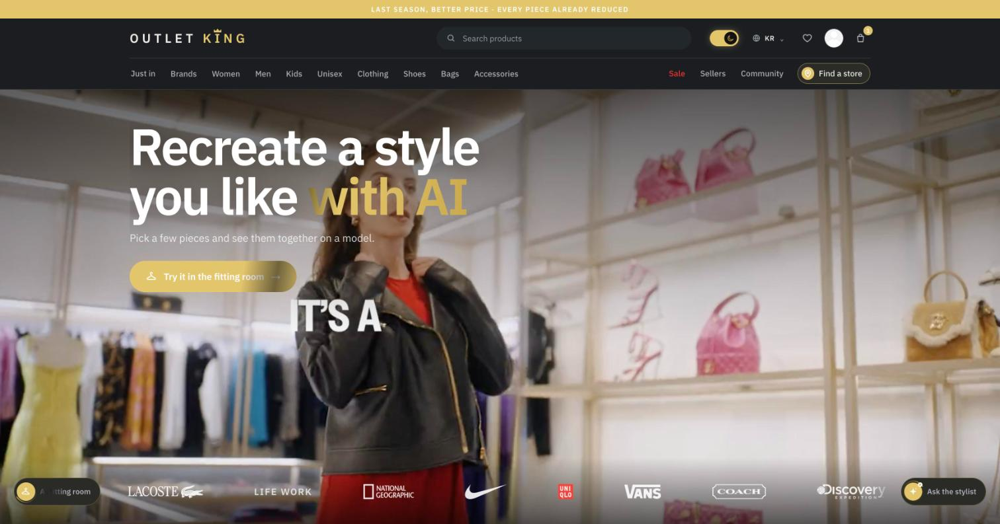
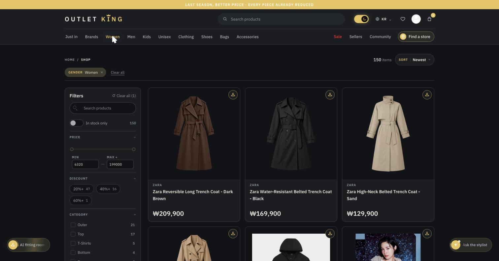
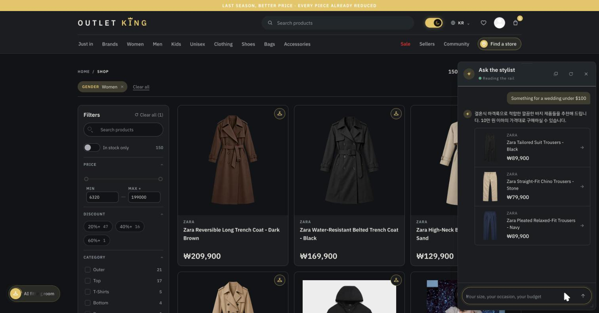
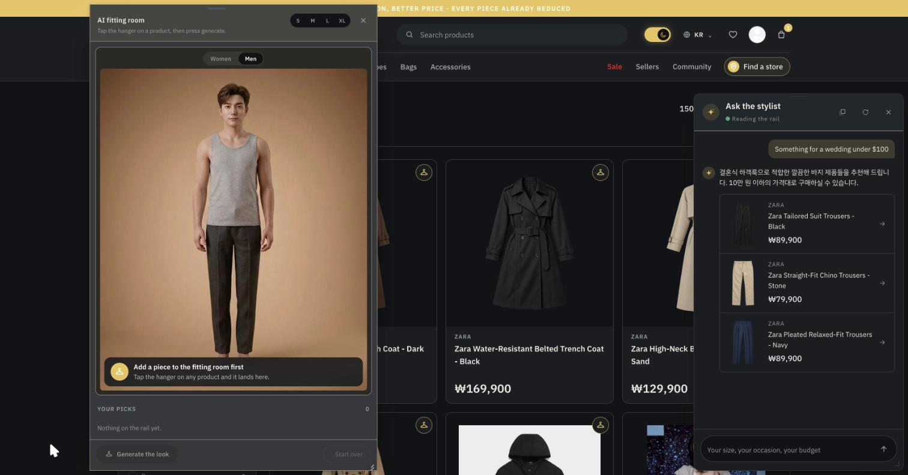

# Outlet King

A production fashion outlet marketplace, live at **[outletking.co.kr](https://outletking.co.kr)**. Last season stock from brands like Lacoste, Nike, Vans and Coach, sold at outlet prices, in Korean, English and Russian.

I designed, built and operate it as the main developer: about 31,000 lines of TypeScript across a NestJS monorepo (API + batch worker) and a Next.js app.

> The source code is private because the shop is a running business. This repo documents what it is and how it works. I walk through the code itself in interviews.



## What's inside

**Shopping.** Catalog of 150+ products with filters (brand, category, gender, price, discount), search, wishlist, cart, orders, product reviews, seller pages and a community board. Dark and light themes, fully responsive, three languages.



**AI stylist.** A customer describes what they need ("something for a wedding under $100") and gets up to 3 real products from the catalog, in their own language. The model only ever answers from catalog data, so it cannot invent a product or a price. On an error or an 8 second timeout it fails over through 3 Gemini models before giving up.



**AI fitting room.** The customer picks pieces from the catalog and sees them together on a model. Image generation runs as BullMQ jobs on Redis, progress streams to the browser over SSE, and a per visitor request limit keeps the API bill predictable.



**Accounts and stores.** Kakao and Google social login over OAuth 2.0 (server side code exchange, redirect allowlist) plus classic JWT auth, and a store finder on Kakao Maps with geocoded store addresses.

## Architecture

```
Next.js app (28 pages, 92 components)
  │  GraphQL over HTTP · WebSocket notifications · SSE progress
  ▼
NestJS API ──── MongoDB (12 models)
  │  ├── Redis (cache, queues)
  │  └── BullMQ workers (image generation)
  │
NestJS batch app: nightly ranking jobs
```

- **API:** code-first GraphQL (Apollo Server), 19 NestJS modules, 61 queries and mutations, 3 JWT guard types (required, role based, optional), strict input validation on every DTO.
- **Frontend:** Next.js, React, TypeScript, a custom MUI + SCSS design system with dark/light theming, WebSocket real-time notifications.
- **Infrastructure:** DigitalOcean droplet that I run myself: Nginx reverse proxy, PM2, UFW, Redis, nightly ranking batch, and a deploy script that rolls back automatically when a build fails.

## Stack

`NestJS` `GraphQL (Apollo, code-first)` `MongoDB` `Redis` `BullMQ` `Next.js` `React` `TypeScript` `MUI` `SCSS` `Socket.io` `Gemini API` `OAuth 2.0 (Kakao, Google)` `Kakao Maps` `Nginx` `PM2` `DigitalOcean`

## Author

**Azamat Solijonov (Allan)** · Seoul · [GitHub profile](https://github.com/Azamat9507) · solijonov.azamat9507@gmail.com
